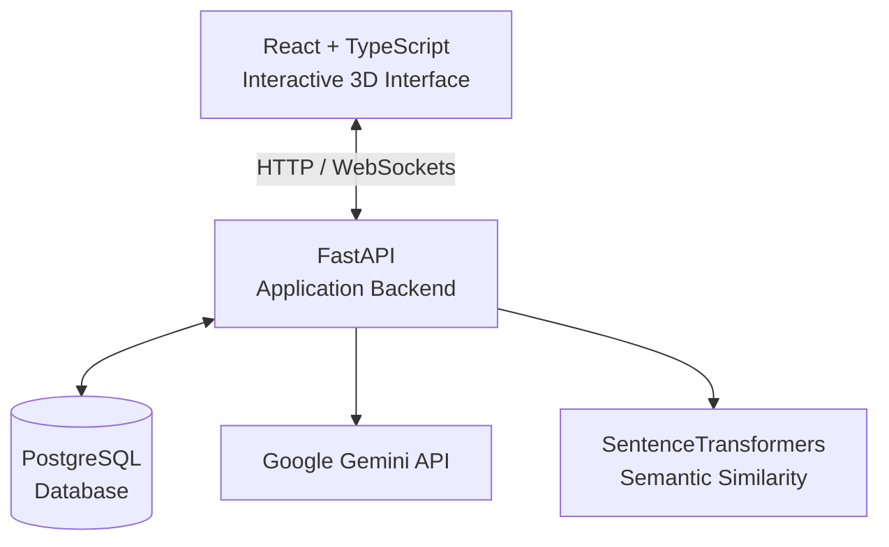

# SOMACA RADAR 🏭

**Industrial Monitoring · Interactive 3D Cartography · Incident Management · AI Assistance**

A factory is made up of hundreds of moving parts. Keeping track of its equipment, understanding what needs attention, and responding to technical incidents shouldn't mean jumping between disconnected tools.

**SOMACA RADAR brings it all into one place.**

Built as a full-stack industrial monitoring application, it combines an interactive 3D factory environment with real-time equipment status, structured incident management, and an AI assistant that helps users explore operational data and past incidents.

The goal is simple: **make information easier to see, incidents easier to follow, and decisions easier to support.**

> Developed during an industrial internship, SOMACA RADAR has been implemented and tested locally using simulated operational data, without a connection to live factory equipment.

---

## 💡What can SOMACA RADAR do?

### Explore the factory in 3D 🗺

The factory isn't represented by a static diagram. It's an interactive environment built with **Three.js and React Three Fiber**, where users can navigate production areas, inspect equipment, and identify machines that need attention.

Equipment status is connected to the application's data, so changes are reflected in the visualization.

### Monitor equipment as things happen

Machines can be operational, require attention, become critical, or have an unknown state.

Through **WebSockets**, changes made in the application are communicated to connected users without requiring a manual refresh. A dedicated factory overview brings these operational indicators together.

### Follow incidents from start to finish

An incident is more than a warning on a screen.

SOMACA RADAR supports the process from reporting a technical problem to documenting its treatment and resolution. Users can track its severity, status, associated machine, interventions, contacts, causes, and solutions.

The application also preserves histories, making it possible to understand how an incident evolved over time.

### Ask SOMACA Helper ⚙️

Instead of navigating through multiple screens to find a specific piece of information, users can ask questions in natural language.

**SOMACA Helper** combines Google's Gemini API with structured database queries to answer questions about machines, incidents, and operational statistics.

It also uses multilingual sentence embeddings to identify historically similar incidents, helping users find relevant previous problems and their documented resolutions.

The assistant is designed to work from verified application data rather than inventing operational facts.

### Keep administration under control

SOMACA RADAR includes dedicated administration features for managing users, equipment, organizational entities, and active sessions.

Access is organized around four roles: **Production Operator, Supervisor, Technician, and Administrator.** Each role has permissions suited to its responsibilities.

---

## 🧩 How it works

The application follows a client–server architecture, with each technology handling a specific responsibility.

| Component | Technology | Responsibility |
|---|---|---|
| Interface | React, TypeScript, Vite | User experience and application navigation |
| 3D environment | Three.js, React Three Fiber, Drei | Interactive factory visualization |
| Backend | Python, FastAPI | Business logic, API endpoints and authorization |
| Database | PostgreSQL, SQLAlchemy | Equipment, incidents, histories and user data |
| Real-time updates | WebSockets | Live synchronization between connected clients |
| AI assistant | Google Gemini | Natural-language interaction |
| Incident similarity | SentenceTransformers, PyTorch | Semantic matching of historical incidents |



The frontend handles interaction and visualization, while FastAPI coordinates authentication, application rules, database operations, and AI-assisted analysis.

---

## 🎬 See it in action

Want to explore SOMACA RADAR without setting up the entire application?

**🌐 Interactive preview:** Link coming soon

The preview will focus on the **frontend experience**, including the interactive 3D factory environment and its visual interface, using demonstration data.

It is not a deployment of the complete system. Backend-dependent features such as authentication, live incident workflows, database operations, and SOMACA Helper are implemented in the full application but are not part of this standalone preview.

---

## 🔐 Security, Access Control & Data Management

SOMACA RADAR uses **JWT authentication with HttpOnly cookies**, server-side session tracking, and **role-based access control (RBAC)** to ensure that users can only access the features and operations permitted by their roles.

Sessions are tracked through hashed tokens and can be revoked, while **rate limiting** helps protect selected API operations from excessive requests.

On the data management side, the application implements **server-side pagination, search, and filtering** to keep administrative operations efficient and manageable, even as the number of records grows.

---

## 📁 Repository Structure

```text
somaca_radar_ai/
├── app/
│   ├── incident_analysis/
│   ├── tests/
│   ├── main.py
│   ├── auth.py
│   ├── database.py
│   ├── models.py
│   ├── schemas.py
│   └── somaca_helper_service.py
├── database/
│   ├── schema.sql
│   └── seed.sql
├── frontend/
│   ├── public/
│   ├── src/
│   ├── package.json
│   └── vite.config.ts
├── .env.example
└── requirements.txt
```

---

## 💻 Running it locally

You'll need a compatible version of **Python**, **Node.js and npm**, and **PostgreSQL**. A Gemini API key is required for the AI assistant's language-model functionality.

### 1. Clone the repository

```bash
git clone https://github.com/salma-akhouad/somaca_radar_ai.git
cd somaca_radar_ai
```

### 2. Configure the backend

Create a Python virtual environment:

```bash
python -m venv .venv
```

Activate it on Windows:

```powershell
.\.venv\Scripts\activate
```

Or on Linux/macOS:

```bash
source .venv/bin/activate
```

Install the dependencies:

```bash
pip install -r requirements.txt
```

### 3. Prepare the database

Create a PostgreSQL database and execute the provided scripts in order:

`database/schema.sql` → `database/seed.sql`

These scripts create the database structure and populate it with demonstration records.

### 4. Configure your environment

Create a `.env` file at the repository root using `.env.example` as a reference.

Configure the PostgreSQL connection, JWT secret, and Gemini API key. Never commit real credentials.

### 5. Start the application

Start the FastAPI backend from the project root:

```bash
uvicorn app.main:app --reload
```

Then, in another terminal, start the frontend:

```bash
cd frontend
npm ci
npm run dev
```

Open **http://localhost:5173** in your browser.

---

## About the project

SOMACA RADAR was developed during an industrial internship as a full-stack engineering project combining interactive visualization, real-time communication, relational database design, secure application workflows, and AI-assisted incident analysis.

From the 3D factory environment to the incident lifecycle and SOMACA Helper, the project brings these technologies together in a single industrial monitoring application.

**Developed and tested locally using simulated operational data.**
